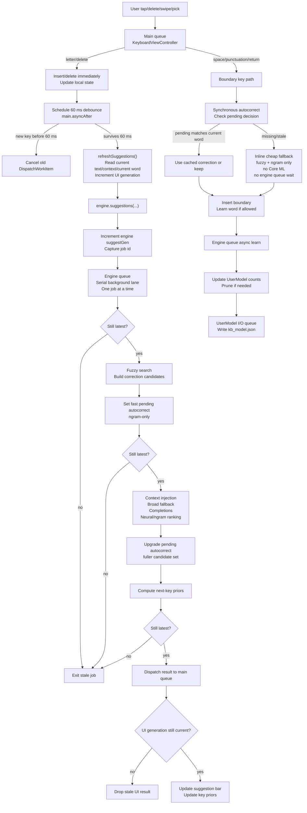

# Keyboard Engine System Flow

This file explains the runtime flow in plain terms. The important distinction is:

- A thread is a physical execution resource owned by the system.
- A DispatchQueue is a lane of work. GCD decides which physical thread runs it.
- In this project, it is clearer to think in "lanes" rather than fixed threads.

## Execution Lanes

| Lane | What it is | What it owns |
|---|---|---|
| Main queue | The UI/input thread | Touches, key handlers, textDocumentProxy edits, debounce timer, UI updates, sync autocorrect fallback |
| Debounce job | A delayed main-queue DispatchWorkItem | Waits 60 ms before starting suggestion refresh; not a separate thread |
| Engine queue | Serial DispatchQueue: `keyboard.engine` | Suggestion computation, ranking, glide decode, learning, previous-word rescue |
| UserModel I/O queue | Serial DispatchQueue: `keyboard.usermodel.io` | Disk write of `kb_model.json` |
| Global utility queue | System background queue | Core ML model loading |
| Locks | Synchronization only | Tiny shared state such as pending correction, generation ids, lexicon/user data |

Code anchors:

- Main UI state: `demo_keyboard/KeyboardViewController.swift:16`
- Engine queue: `keyboard/Engine/Keyboardengine.swift:32`
- Pending autocorrect state: `keyboard/Engine/Keyboardengine.swift:111`
- Engine generation lock: `keyboard/Engine/Keyboardengine.swift:639`
- UserModel I/O queue: `keyboard/Engine/UserModel.swift:119`
- Neural model load queue: `keyboard/Engine/NeuralScorer.swift:221`

## High-Level Flow



## What Happens When Typing A Normal Letter

1. `KeyboardView` sends the key to `KeyboardViewController`.
2. `handleInsert` inserts the letter immediately.
3. `handleInsert` calls `scheduleSuggestions()`.
4. `scheduleSuggestions()` cancels the previous pending debounce job.
5. It schedules a new `DispatchWorkItem` using `DispatchQueue.main.asyncAfter(...0.06...)`.
6. If another key arrives within 60 ms, the old debounce job is cancelled.
7. If there is a 60 ms pause, `refreshSuggestions()` runs on the main queue.
8. `refreshSuggestions()` snapshots the text context and calls `engine.suggestions(...)`.
9. The engine submits the real suggestion work to the serial engine queue.

Code anchors:

- Main key handler: `demo_keyboard/KeyboardViewController.swift:283`
- Normal character insert: `demo_keyboard/KeyboardViewController.swift:334`
- Debounce scheduler: `demo_keyboard/KeyboardViewController.swift:664`
- `main.asyncAfter(...0.06...)`: `demo_keyboard/KeyboardViewController.swift:668`
- Debounce fires: `demo_keyboard/KeyboardViewController.swift:671`
- Non-empty-word engine call: `demo_keyboard/KeyboardViewController.swift:694`

## What Happens On Space, Punctuation, Or Return

Boundary keys are different because they may commit the current word.

1. `handleInsert` detects a boundary character.
2. It calls `applyAutocorrectIfNeeded()` before inserting the boundary.
3. `applyAutocorrectIfNeeded()` calls `engine.autocorrection(...)` synchronously.
4. The engine first checks `pending`, the cached autocorrect decision from the async suggestion pass.
5. If `pending.word` matches the current word, it uses that decision.
6. If no pending decision exists, or it is stale, it computes a cheap inline fallback.
7. The fallback uses fuzzy search plus n-gram ranking only.
8. The fallback does not call Core ML and does not wait for the engine queue.

Code anchors:

- Boundary split: `demo_keyboard/KeyboardViewController.swift:316`
- Sync autocorrect call: `demo_keyboard/KeyboardViewController.swift:551`
- Engine sync autocorrect entry: `keyboard/Engine/Keyboardengine.swift:207`
- Read pending helper: `keyboard/Engine/Keyboardengine.swift:116`
- Pending checked against current word: `keyboard/Engine/Keyboardengine.swift:212`
- Correction decision logic: `keyboard/Engine/Keyboardengine.swift:229`

## Engine Queue Details

The engine queue is created as:

```swift
private let queue = DispatchQueue(label: "keyboard.engine")
```

That is serial by default. Serial means GCD runs only one submitted engine job at a time:

1. job A starts
2. job A finishes
3. job B starts
4. job B finishes

It is not a permanently pinned thread. It is a single-file lane. GCD may run it on different physical system threads over time, but the queue preserves one-at-a-time ordering.

Code anchors:

- Engine queue definition: `keyboard/Engine/Keyboardengine.swift:32`
- Engine suggestions entry: `keyboard/Engine/Keyboardengine.swift:734`
- Submit suggestion job to engine queue: `keyboard/Engine/Keyboardengine.swift:737`
- Glide also uses engine queue: `keyboard/Engine/Keyboardengine.swift:421`
- Previous-word rescue uses engine queue: `keyboard/Engine/Keyboardengine.swift:583`
- Learning uses engine queue: `keyboard/Engine/Keyboardengine.swift:841`

## Engine Suggestion Job Internals

After `refreshSuggestions()` calls `engine.suggestions(...)`, the engine does this:

1. Increment `suggestGen`.
2. Capture that value as this job's id.
3. Submit a closure to the serial engine queue.
4. When the job starts, check if it is still latest.
5. If stale, return immediately.
6. If current, compute candidates.
7. Set a fast pending autocorrect decision.
8. Check freshness again.
9. Run heavier candidate sources and ranking.
10. Upgrade pending autocorrect.
11. Compute next-key priors.
12. Check freshness again.
13. Dispatch result back to the main queue.

Code anchors:

- Increment `suggestGen`: `keyboard/Engine/Keyboardengine.swift:736`
- Fuzzy correction search: `keyboard/Engine/Keyboardengine.swift:750`
- Set fast pending autocorrect: `keyboard/Engine/Keyboardengine.swift:755`
- Context injection: `keyboard/Engine/Keyboardengine.swift:764`
- Broad fallback: `keyboard/Engine/Keyboardengine.swift:770`
- Ranking: `keyboard/Engine/Keyboardengine.swift:802`
- Upgrade pending autocorrect: `keyboard/Engine/Keyboardengine.swift:812`
- Next-key priors: `keyboard/Engine/Keyboardengine.swift:818`
- Dispatch completion to main queue: `keyboard/Engine/Keyboardengine.swift:821`

## Cancellation And Freshness

There is no hard kill for a running engine suggestion job.

There are two kinds of protection:

### 1. Debounce cancellation

Before engine work exists, the controller can cancel the pending 60 ms debounce job.

Code anchors:

- `suggestWork` storage: `demo_keyboard/KeyboardViewController.swift:17`
- Cancel previous debounce: `demo_keyboard/KeyboardViewController.swift:665`
- Schedule new debounce: `demo_keyboard/KeyboardViewController.swift:668`

### 2. Generation checks

After engine work has been submitted, it cannot be removed from the queue or killed. Instead it checks whether it is stale.

The engine-side id is `suggestGen`.

Code anchors:

- `genLock` and `suggestGen`: `keyboard/Engine/Keyboardengine.swift:639`
- Engine id increment: `keyboard/Engine/Keyboardengine.swift:736`

The UI-side id is `generation`.

Code anchors:

- UI generation storage: `demo_keyboard/KeyboardViewController.swift:16`
- UI generation increment: `demo_keyboard/KeyboardViewController.swift:673`
- Empty-word callback guard: `demo_keyboard/KeyboardViewController.swift:682`
- Non-empty callback guard: `demo_keyboard/KeyboardViewController.swift:695`

Simple rule:

- Debounce cancellation prevents many engine jobs from being created.
- Generation checks make already-created stale jobs exit early.
- Stale jobs are not killed while already running.
- Stale jobs are prevented from updating the UI.

## Accept, Reject, And Learning Rules

### Autocorrect accepted

If the user keeps typing after an autocorrect, the controller treats the correction as accepted.

Code anchors:

- Acceptance helper: `demo_keyboard/KeyboardViewController.swift:256`
- Engine acceptance method: `keyboard/Engine/Keyboardengine.swift:358`

### Autocorrect rejected

If the user presses backspace immediately after an autocorrect, the controller restores the original typed word and tells the engine not to correct it again this session.

Code anchors:

- Backspace handler: `demo_keyboard/KeyboardViewController.swift:419`
- Calls `dontCorrect`: `demo_keyboard/KeyboardViewController.swift:457`
- Engine `dontCorrect`: `keyboard/Engine/Keyboardengine.swift:345`

### Manual fix

If the user erases a word and commits a different word, the old word is treated as a mistake and is demoted.

Code anchors:

- Manual fix resolution: `demo_keyboard/KeyboardViewController.swift:649`
- Engine `wordReplaced`: `keyboard/Engine/Keyboardengine.swift:368`

### Suggestion pick

Picking a suggestion replaces or inserts text depending on mode:

- `.complete`: replace current partial word, learn picked word
- `.predict`: insert picked word, learn it
- `.revert`: restore original word and suppress that correction
- `.glided`: replace glided word with selected alternative

Code anchors:

- Suggestion pick handler: `demo_keyboard/KeyboardViewController.swift:473`
- Completion learn: `demo_keyboard/KeyboardViewController.swift:501`
- Prediction learn: `demo_keyboard/KeyboardViewController.swift:510`
- Revert handling: `demo_keyboard/KeyboardViewController.swift:514`
- Glide alternative handling: `demo_keyboard/KeyboardViewController.swift:524`

## Work Inside The Engine

These are the deeper components called from the engine queue.

| Component | File / line |
|---|---|
| Lexicon fuzzy corrections | `keyboard/Engine/Lexicon.swift:105` |
| Lexicon broad corrections | `keyboard/Engine/Lexicon.swift:120` |
| Lexicon completions | `keyboard/Engine/Lexicon.swift:158` |
| Lexicon next-key priors | `keyboard/Engine/Lexicon.swift:134` |
| Lexicon profanity/safety check | `keyboard/Engine/Lexicon.swift:50` |
| N-gram candidate scoring | `keyboard/Engine/NgramScorer.swift:31` |
| N-gram next-word predictions | `keyboard/Engine/NgramScorer.swift:94` |
| Neural readiness | `keyboard/Engine/NeuralScorer.swift:195` |
| Neural model loading | `keyboard/Engine/NeuralScorer.swift:200` |
| Neural candidate scoring | `keyboard/Engine/NeuralScorer.swift:260` |
| Neural next-word beam search | `keyboard/Engine/NeuralScorer.swift:413` |
| UserModel learning | `keyboard/Engine/UserModel.swift:122` |
| UserModel save | `keyboard/Engine/UserModel.swift:164` |
| Disk write of user model | `keyboard/Engine/UserModel.swift:174` |

## Short Mental Model

```text
Letter typed:
    Main queue inserts letter now.
    Main queue schedules 60 ms debounce.

If more typing happens before 60 ms:
    Old debounce is cancelled.

If 60 ms pause happens:
    Main queue snapshots text.
    Main queue calls engine.suggestions.
    Engine queue computes suggestions and pending autocorrect.
    Engine queue sends result back to main.
    Main queue updates suggestion bar only if still current.

Boundary typed:
    Main queue calls sync autocorrect immediately.
    It uses pending if available.
    Otherwise it computes cheap n-gram fallback inline.
    Then it inserts the boundary and learns the word if allowed.
```
